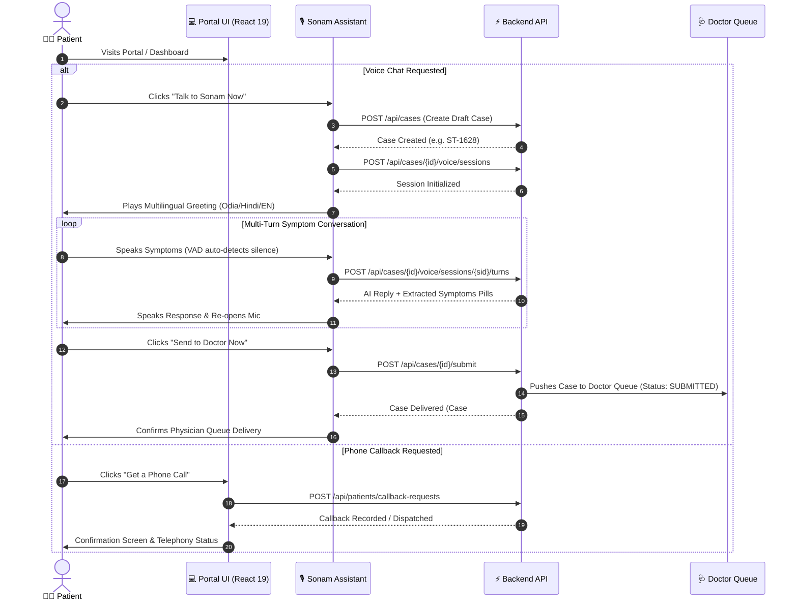
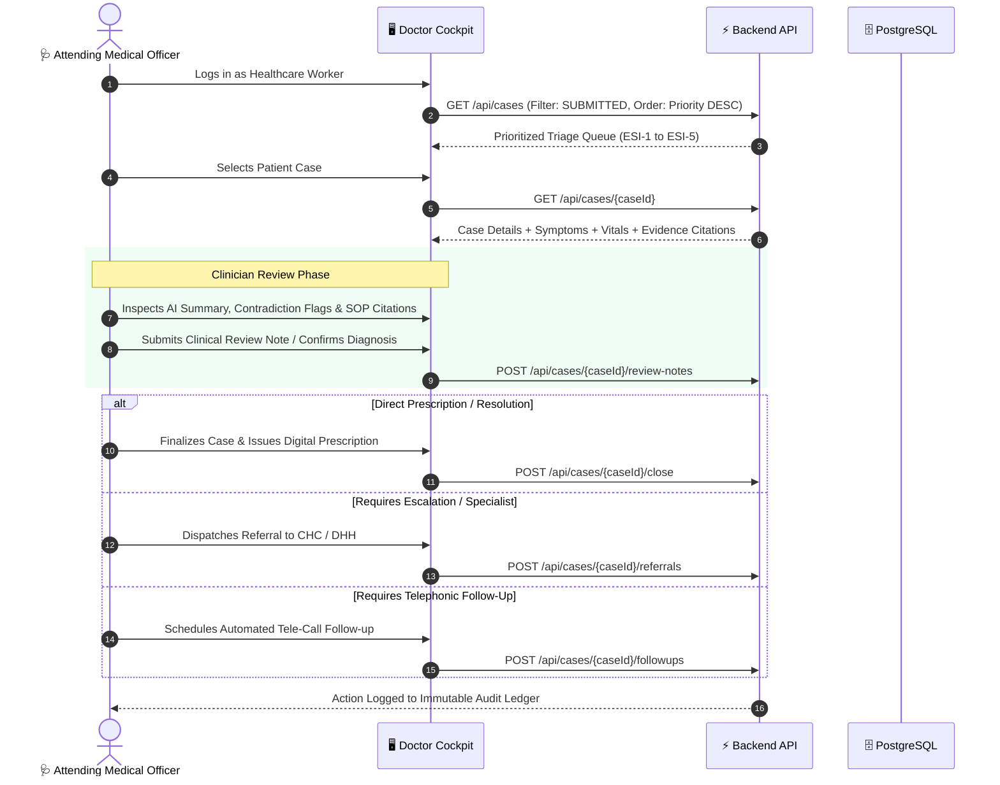
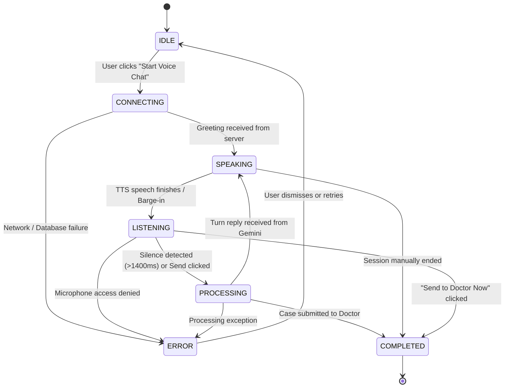
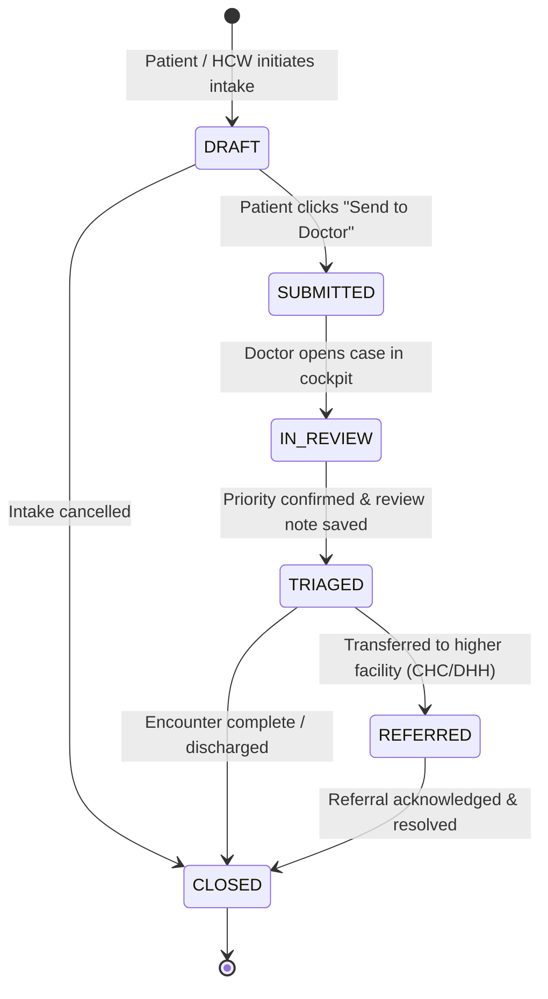
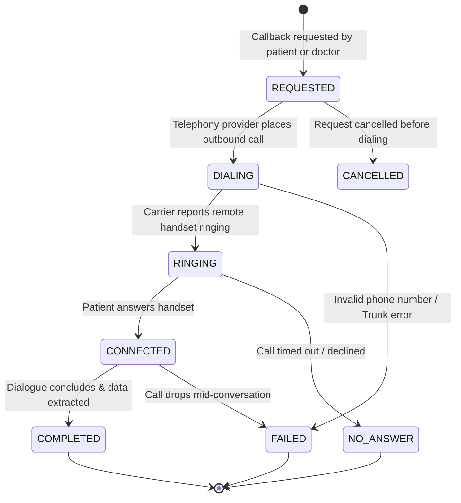

# 🔄 Application Flow & State Machines (APP_FLOW)
## SwasthyaFlow AI — Interactive Clinical Journeys, State Transitions & Protocols

---

## 1. End-to-End User Journeys

### 1.1 Patient Journey: AI Voice Intake to Doctor Handoff



---

### 1.2 Healthcare Worker & Doctor Clinical Review Journey



---

## 2. Finite State Machines (FSM)

### 2.1 Voice Assistant Session State Machine (`AssistantState`)



#### State Definitions:
- **`IDLE`**: Initial floating pill state; microphone is inactive.
- **`CONNECTING`**: Drafting case and acquiring public session identifier.
- **`SPEAKING`**: Audio synthesis is actively playing Sonam's response.
- **`LISTENING`**: Microphone is open, AnalyserNode evaluates RMS loudness.
- **`PROCESSING`**: Audio buffer uploaded, Gemini clinical NLP extraction active.
- **`COMPLETED`**: Intake delivered to doctor; final confirmation displayed.
- **`ERROR`**: Exception encountered (displayed with actionable fallback).

---

### 2.2 Case Lifecycle State Machine (`CaseStatus`)



---

### 2.3 Tele-Call Lifecycle State Machine (`CallStatus`)



---

## 3. Emergency Red Flag Escalation Protocol

```
                        [Symptom Extracted]
                                │
          ┌─────────────────────┴─────────────────────┐
          ▼                                           ▼
[Cardiac / Respiratory Signs]                [Severe Pediatric / Trauma]
 • Chest pain radiating to left arm           • Lethargy with sunken eyes
 • Resting SpO2 < 90%                         • Continuous seizures
 • Severe stridor / cyanosis                  • Active arterial bleed
          │                                           │
          └─────────────────────┬─────────────────────┘
                                │
                                ▼
                     [CRITICAL RED FLAG DETECTED]
                                │
       ┌────────────────────────┴────────────────────────┐
       ▼                                                 ▼
[Patient Portal UI]                              [Doctor Review Queue]
 1. Flash High-Contrast Red Alert                 1. Escalate Case to Priority: EMERGENCY
 2. Prominent Ambulance Links:                    2. Pin Case to #1 Position in Queue
    • 112 (National Emergency)                    3. Trigger Audio Chime in Doctor Cockpit
    • 108 (State Ambulance)                       4. Highlight Immediate Life Support Protocol
 3. Supplementary Desk: 6370659934
```

---

## 4. Offline Synchronization Protocol

1. **Local Mutation**: Frontline worker submits vitals while offline $\rightarrow$ Action saved to IndexedDB table `sync_mutations` with timestamp and unique UUID.
2. **Connectivity Listener**: Window listener monitors `online` event and periodic heartbeat ping to `/api/health`.
3. **Sequential Replay**: Upon network restoration, requests are drained FIFO from IndexedDB and submitted to backend with `X-Idempotency-Key`.
4. **Conflict Resolution**: Server applies Last-Write-Wins (LWW) based on server-verified timestamps; errors are moved to the user's manual review drawer.
