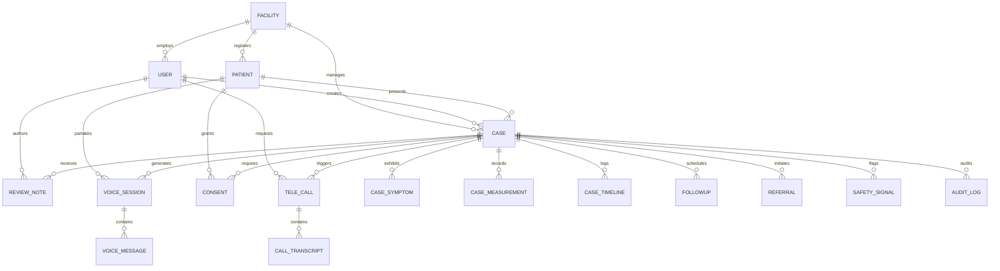

# 🗄️ Backend Database Schema & Data Models (BACKEND_SCHEMA)
## SwasthyaFlow AI — PostgreSQL Relational Schema, SQLAlchemy Models & Pydantic DTOs

---

## 1. Entity Relationship Diagram (ERD)



---

## 2. Core Tables & Column Specifications

### 2.1 Facilities (`facilities`)
| Column | Type | Constraints | Description |
|---|---|---|---|
| `id` | `INTEGER` | `PRIMARY KEY` | Auto-incrementing primary key |
| `code` | `VARCHAR(32)` | `UNIQUE, NOT NULL, INDEX` | Unique facility code (e.g., `PHC-OD-BBSR-01`) |
| `name` | `VARCHAR(255)` | `NOT NULL` | Facility name |
| `facility_type` | `VARCHAR(32)` | `NOT NULL` | `PHC`, `CHC`, `DHH`, `SUB_CENTRE` |
| `state` | `VARCHAR(64)` | `NOT NULL` | State (e.g., `Odisha`) |
| `district` | `VARCHAR(64)` | `NOT NULL` | District (e.g., `Khordha`) |
| `address` | `TEXT` | `NULLABLE` | Street address and postal code |
| `phone` | `VARCHAR(32)` | `NULLABLE` | Facility contact desk |
| `is_active` | `BOOLEAN` | `DEFAULT TRUE` | Active facility status |

---

### 2.2 Users & Authentication (`users`)
| Column | Type | Constraints | Description |
|---|---|---|---|
| `id` | `INTEGER` | `PRIMARY KEY` | Primary user identifier |
| `email` | `VARCHAR(255)` | `UNIQUE, NOT NULL, INDEX` | Unique login email |
| `hashed_password` | `VARCHAR(255)` | `NOT NULL` | Argon2id password hash |
| `full_name` | `VARCHAR(255)` | `NOT NULL` | User full name |
| `role` | `ENUM(Role)` | `NOT NULL, INDEX` | `PATIENT`, `HEALTHCARE_WORKER`, `FACILITY_ADMIN`, `SUPER_ADMIN` |
| `facility_id` | `INTEGER` | `FK(facilities.id), INDEX` | Facility scoping for healthcare workers and admins |
| `designation` | `VARCHAR(128)` | `NULLABLE` | Official title (e.g., *Medical Officer*, *Staff Nurse*) |
| `phone` | `VARCHAR(32)` | `NULLABLE` | Contact telephone number |
| `is_active` | `BOOLEAN` | `DEFAULT TRUE` | User account active flag |
| `last_login_at` | `TIMESTAMPTZ` | `NULLABLE` | Last login timestamp |

---

### 2.3 Patients (`patients`)
| Column | Type | Constraints | Description |
|---|---|---|---|
| `id` | `INTEGER` | `PRIMARY KEY` | Patient identifier |
| `public_id` | `VARCHAR(32)` | `UNIQUE, NOT NULL, INDEX` | Public external UUID identifier |
| `user_id` | `INTEGER` | `FK(users.id), UNIQUE, NULL`| Associated portal user account if registered |
| `facility_id` | `INTEGER` | `FK(facilities.id), NOT NULL`| Primary registering facility |
| `full_name` | `VARCHAR(255)` | `NOT NULL` | Patient full legal name |
| `phone` | `VARCHAR(32)` | `NULLABLE` | Contact phone number |
| `age` | `INTEGER` | `NULLABLE` | Patient age in years |
| `gender` | `VARCHAR(16)` | `NULLABLE` | `MALE`, `FEMALE`, `OTHER` |
| `preferred_language`| `VARCHAR(8)` | `DEFAULT 'en'` | Preferred dialect (`od`, `hi`, `en`) |

---

### 2.4 Clinical Cases (`cases`)
| Column | Type | Constraints | Description |
|---|---|---|---|
| `id` | `INTEGER` | `PRIMARY KEY` | Internal case sequence ID |
| `case_number` | `VARCHAR(32)` | `UNIQUE, NOT NULL, INDEX` | Public case code (e.g., `ST-1628`) |
| `patient_id` | `INTEGER` | `FK(patients.id), NOT NULL` | Presenting patient |
| `facility_id` | `INTEGER` | `FK(facilities.id), NOT NULL` | Handling healthcare facility |
| `created_by_user_id`| `INTEGER` | `FK(users.id), NOT NULL` | Creator user |
| `status` | `ENUM(CaseStatus)` | `NOT NULL, INDEX` | `DRAFT`, `SUBMITTED`, `IN_REVIEW`, `TRIAGED`, `CLOSED` |
| `priority` | `ENUM(Priority)` | `NOT NULL, INDEX` | `EMERGENCY`, `URGENT`, `PRIORITY`, `ROUTINE` |
| `source` | `ENUM(CaseSource)` | `NOT NULL` | `VOICE`, `CHAT`, `OCR`, `WALK_IN` |
| `language` | `ENUM(Language)` | `NOT NULL` | Primary intake language (`od`, `hi`, `en`) |
| `chief_concern` | `TEXT` | `NULLABLE` | Primary symptom complaint summary |
| `missing_information`| `JSON` | `DEFAULT '[]'` | AI-identified missing clinical data |
| `created_at` | `TIMESTAMPTZ` | `DEFAULT now(), INDEX` | Case creation timestamp |

---

### 2.5 Consents (`consents`)
> [!IMPORTANT]
> `consent_text_version` is constrained to `VARCHAR(16)`. Strings longer than 16 characters will raise `StringDataRightTruncation` in PostgreSQL. Backend and frontend must always use versions $\le 16$ characters (e.g., `'v1'`, `'v1_sonam'`).

| Column | Type | Constraints | Description |
|---|---|---|---|
| `id` | `INTEGER` | `PRIMARY KEY` | Internal sequence ID |
| `patient_id` | `INTEGER` | `FK(patients.id), NOT NULL` | Consenting patient |
| `case_id` | `INTEGER` | `FK(cases.id), NOT NULL` | Associated clinical case |
| `status` | `ENUM(ConsentStatus)` | `NOT NULL` | `GRANTED`, `REVOKED`, `PENDING` |
| `consent_text_version`| `VARCHAR(16)` | `NOT NULL, DEFAULT 'v1'` | **Max 16 characters** consent version |
| `language` | `ENUM(Language)` | `NOT NULL` | Language presented for consent |
| `granted_at` | `TIMESTAMPTZ` | `DEFAULT now()` | Timestamp of consent acceptance |

---

### 2.6 Voice Sessions & Messages (`voice_sessions`, `voice_messages`)

#### `voice_sessions`
| Column | Type | Constraints | Description |
|---|---|---|---|
| `id` | `INTEGER` | `PRIMARY KEY` | Sequence identifier |
| `public_id` | `VARCHAR(32)` | `UNIQUE, NOT NULL, INDEX` | Public session UUID |
| `case_id` | `INTEGER` | `FK(cases.id), NOT NULL, INDEX` | Associated case |
| `patient_id` | `INTEGER` | `FK(patients.id), NOT NULL` | Presenting patient |
| `mode` | `ENUM(VoiceSessionMode)` | `NOT NULL` | `IN_APP` |
| `status` | `ENUM(SessionStatus)` | `NOT NULL, INDEX` | `IDLE`, `PROCESSING`, `COMPLETED`, `ERROR` |
| `provider` | `VARCHAR(32)` | `NOT NULL` | Voice agent provider (`gemini_live`, `sonam`) |
| `language` | `VARCHAR(8)` | `NOT NULL` | Language code (`od`, `hi`, `en`) |
| `started_at` | `TIMESTAMPTZ` | `DEFAULT now()` | Session start time |
| `ended_at` | `TIMESTAMPTZ` | `NULLABLE` | Session termination time |

#### `voice_messages`
| Column | Type | Constraints | Description |
|---|---|---|---|
| `id` | `INTEGER` | `PRIMARY KEY` | Message sequence ID |
| `session_id` | `INTEGER` | `FK(voice_sessions.id), NOT NULL`| Parent voice session |
| `sequence` | `INTEGER` | `NOT NULL` | Turn index within session |
| `role` | `VARCHAR(16)` | `NOT NULL` | `PATIENT`, `AI`, `SYSTEM` |
| `transcript` | `TEXT` | `NOT NULL` | Message text content |
| `created_at` | `TIMESTAMPTZ` | `DEFAULT now()` | Turn timestamp |

---

### 2.7 Telephony Calls & Transcripts (`tele_calls`, `call_transcripts`)

#### `tele_calls`
| Column | Type | Constraints | Description |
|---|---|---|---|
| `id` | `INTEGER` | `PRIMARY KEY` | Sequence ID |
| `public_id` | `VARCHAR(40)` | `UNIQUE, NOT NULL, INDEX` | Public external call ID |
| `case_id` | `INTEGER` | `FK(cases.id), NOT NULL, INDEX` | Associated case |
| `followup_id` | `INTEGER` | `FK(followups.id), NULLABLE` | Linked follow-up task |
| `requested_by_user_id`| `INTEGER` | `FK(users.id), NULLABLE` | Healthcare worker or patient requester |
| `provider` | `VARCHAR(32)` | `NOT NULL, DEFAULT 'mock'` | `snapserve`, `videosdk`, `mock` |
| `phone_number` | `VARCHAR(32)` | `NULLABLE` | Normalized E.164 phone number |
| `status` | `ENUM(CallStatus)` | `NOT NULL, INDEX` | `REQUESTED`, `DIALING`, `RINGING`, `CONNECTED`, `COMPLETED`, `FAILED`, `NO_ANSWER` |
| `direction` | `VARCHAR(16)` | `DEFAULT 'OUTBOUND'` | Call direction |
| `reason` | `TEXT` | `NULLABLE` | Clinical reason for outbound call |
| `questions` | `JSON` | `DEFAULT '[]'` | Structured questions for patient verification |
| `extracted_data` | `JSON` | `NULLABLE` | Vitals and symptoms extracted during call |
| `duration_seconds` | `INTEGER` | `NULLABLE` | Total connected duration |
| `started_at` | `TIMESTAMPTZ` | `NULLABLE` | Call initiation timestamp |
| `ended_at` | `TIMESTAMPTZ` | `NULLABLE` | Call hangup timestamp |

#### `call_transcripts`
| Column | Type | Constraints | Description |
|---|---|---|---|
| `id` | `INTEGER` | `PRIMARY KEY` | Transcript turn ID |
| `call_id` | `INTEGER` | `FK(tele_calls.id), NOT NULL` | Parent tele-call |
| `sequence` | `INTEGER` | `NOT NULL` | Turn sequence number |
| `role` | `ENUM(MessageRole)` | `NOT NULL` | `AI`, `PATIENT`, `SYSTEM` |
| `content` | `TEXT` | `NOT NULL` | Utterance content |
| `language` | `VARCHAR(8)` | `NULLABLE` | Language of utterance |
| `created_at` | `TIMESTAMPTZ` | `DEFAULT now()` | Utterance timestamp |

---

## 3. Database Enumerations (`models/enums.py`)

```python
class Role(str, enum.Enum):
    PATIENT = "PATIENT"
    HEALTHCARE_WORKER = "HEALTHCARE_WORKER"
    FACILITY_ADMIN = "FACILITY_ADMIN"
    SUPER_ADMIN = "SUPER_ADMIN"

class CaseStatus(str, enum.Enum):
    DRAFT = "DRAFT"
    SUBMITTED = "SUBMITTED"
    IN_REVIEW = "IN_REVIEW"
    TRIAGED = "TRIAGED"
    CLOSED = "CLOSED"

class Priority(str, enum.Enum):
    EMERGENCY = "EMERGENCY"  # ESI-1 / ESI-2
    URGENT = "URGENT"        # ESI-3
    PRIORITY = "PRIORITY"    # ESI-4
    ROUTINE = "ROUTINE"      # ESI-5

class CallStatus(str, enum.Enum):
    REQUESTED = "REQUESTED"
    DIALING = "DIALING"
    RINGING = "RINGING"
    CONNECTED = "CONNECTED"
    COMPLETED = "COMPLETED"
    FAILED = "FAILED"
    NO_ANSWER = "NO_ANSWER"
    CANCELLED = "CANCELLED"

class Language(str, enum.Enum):
    EN = "en"
    HI = "hi"
    OD = "od"
```
