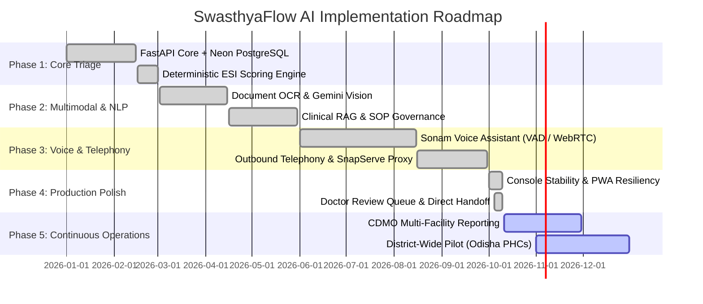

# 📋 Implementation Plan & Verification Matrix (IMPLEMENTATION_PLAN)
## SwasthyaFlow AI — Milestones, Quality Assurance & Production Maintenance

---

## 1. Roadmap & Implementation Milestones



---

## 2. Milestone Deliverables Summary

| Milestone | Deliverables | Key Components | Status |
|---|---|---|---|
| **M1: Foundation** | Secure backend, Neon PostgreSQL connection, Argon2id auth, RBAC, Single-Role enforcement. | `backend/main.py`, `auth/`, `models/` | ✅ Complete |
| **M2: Clinical AI Core** | 6-stage clinical orchestration, deterministic ESI triage, contradiction detector, evidence ledger. | `services/orchestration/`, `services/triage/` | ✅ Complete |
| **M3: Multimodal Intake** | Odia, Hindi, English multilingual voice transcription, prescription OCR, RAG SOP guidance. | `services/voice/`, `services/ocr/`, `services/rag/` | ✅ Complete |
| **M4: Sonam Voice Agent** | In-app voice assistant, Web Audio VAD (1.4s silence cutoff), streaming turns, doctor queue submission. | `SonamFloatingAssistant.tsx`, `api/voice.py` | ✅ Complete |
| **M5: Outbound Telephony** | Patient callback queue, SnapServe PSTN dialing, safe webhook ingestion, admin email alerts. | `services/telephony/`, `api/telecalls.py` | ✅ Complete |
| **M6: Zero-Console Error** | PWA icon generation, Workbox `navigateFallback: null`, JWT expiration check in `getAccessToken()`. | `vite.config.ts`, `api.ts`, `main.tsx` | ✅ Complete |

---

## 3. Incident History & Bug Resolution Ledger

| Incident | Root Cause | Impact | Resolution Applied | Verification |
|---|---|---|---|---|
| **500 on Case Creation with Sonam** | `consent_text_version` was passed as `'v1_sonam_floating'` (17 chars), exceeding `VARCHAR(16)` in PostgreSQL. | Prevented patients from starting Sonam intake. | Shortened client string to `'v1_sonam'`; added defensive slicing `[:16]` in `backend/api/cases.py`. | E2E Python test: Case creation returns **201 Created**. |
| **500 on `/api/telecalls?page_size=30`** | `TranscriptOut` lacked Pydantic ORM compatibility (`from_attributes=True`); strict enum validation failed on transcripts. | Healthcare workers saw 500 when opening Tele-calls page. | Added `model_config = ConfigDict(from_attributes=True)`, made `role: str`, and wrapped row serialization safely. | Live endpoint returns **200 OK** (21 records loaded). |
| **Workbox `non-precached-url: index.html`** | Workbox default `navigateFallback: 'index.html'` called `createHandlerBoundToURL` on un-precached HTML. | Uncaught Promise error on initial page visit. | Set `navigateFallback: null` in `vite.config.ts` and included compiled bundles in `globPatterns`. | Live `sw.js` completely free of `createHandlerBoundToURL`. |
| **401 on `/api/auth/me` on Login Page** | `getAccessToken()` returned expired token string from `localStorage`, causing doomed auth request. | Red 401 error logged in browser console. | Added client-side JWT expiration check `isTokenValid(token)`; auto-purges stale tokens before fetch. | Zero unauthenticated 401 calls on splash or login. |
| **PWA Icon 404 (`/icons/icon-192.png`)** | Manifest referenced `/icons/` directory that did not exist in `frontend/public/`. | Manifest download error in browser console. | Generated `icon-192.png` and `icon-512.png` in `frontend/public/icons/`. | HTTP **200 OK** on both icons. |

---

## 4. Quality Assurance & Verification Suite

### 4.1 End-to-End Live Verification Script
The repository maintains an automated smoke test suite in `scratch/verify_console_fixes.py` and `scratch/test_live_sonam.py` that verifies live production deployments:

```python
# Verification Lifecycle:
# 1. Health Probe (/api/health)
# 2. Icon Asset Availability (/icons/icon-192.png, /icons/icon-512.png)
# 3. Staff Authentication & Facility Scoping
# 4. Tele-Call Retrieval (/api/telecalls?page_size=30)
# 5. Follow-Up Obligations Retrieval (/api/followups?page_size=100)
# 6. Patient Login -> Draft Case -> Sonam Voice Session -> Audio Turn -> Direct Doctor Queue Handoff
```

### 4.2 Test Execution Command Matrix
```bash
# Backend pytest suite (Deterministic Mock Telephony)
cd backend && .venv/Scripts/python -m pytest -v

# Frontend TypeScript check and production build
cd frontend && npm run build

# Python syntax & bytecode compilation check
python -m compileall backend server.py
```

---

## 5. Continuous Deployment & Production Operations

### 5.1 Deployment Pipeline
- **Repository**: [GitHub: Shubham809380/SwasthyaTriage-AI](https://github.com/Shubham809380/SwasthyaTriage-AI) (Branch: `main`)
- **Hosting**: Unified Vercel Serverless Function (`server:app` + built Vite SPA)
- **Production Alias**: `https://swasthyatriage-ai-azure.vercel.app`
- **Build Hook**: `python build_frontend.py` automatically compiles the SPA before deploying Python bytecode.

### 5.2 Ongoing Maintenance Checklist
1. **Model Drift Monitoring**: Review `/api/eval/metrics` monthly for clinical extraction accuracy.
2. **Neon Database Backups**: Verify daily automatic point-in-time recovery (PITR) snapshots.
3. **Audit Log Verification**: Confirm immutable audit sequence integrity for clinician overrides.
4. **Telephony Quality Check**: Monitor carrier connect rates on outbound follow-ups.
