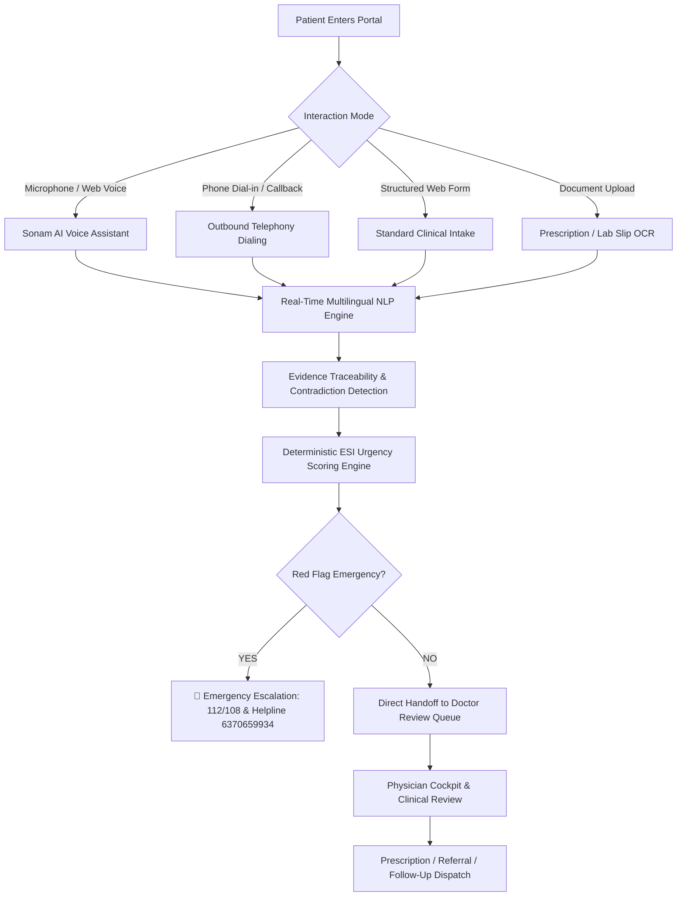

# 📄 Product Requirements Document (PRD)
## SwasthyaFlow AI — Multimodal Healthcare Triage & AI Voice Assistant (Sonam)

---

## 1. Executive Summary

**SwasthyaFlow AI** (historically *SwasthyaTriage AI*) is an institutional-grade, multimodal clinical decision-support and triage platform designed for peripheral healthcare facilities across India, including Primary Healthcare Centers (PHCs), Community Health Centers (CHCs), and District Headquarters Hospitals (DHHs).

The platform introduces **Sonam AI**, an empathetic, multilingual voice assistant capable of conducting patient symptom intake in **Odia**, **Hindi**, and **English**, detecting critical emergencies, and delivering structured clinical intakes directly into qualified physicians' review queues.

> **Core Operating Principle:**  
> *AI assists and structures. Qualified healthcare professionals decide.*  
> The system is non-diagnostic and human-in-the-loop by design, strictly compliant with clinical governance rules, Ayushman Bharat Digital Mission (ABDM) standards, and the DISHA Act guidelines.

---

## 2. Problem Statement & User Personas

### 2.1 The Peripheral Healthcare Problem
1. **Extreme OPD Congestion**: Attending Medical Officers face 150–250+ patients per shift with 2–3 minutes per consultation.
2. **Linguistic & Literacy Barriers**: Rural patients describe complex clinical histories in regional dialects (e.g., Sambalpuri Odia, Desia, rural Hindi) that urban-trained doctors find time-consuming to extract.
3. **Delayed Emergency Detection**: Life-threatening conditions (e.g., acute myocardial infarction, hypertensive encephalopathy, severe pediatric dehydration, postpartum hemorrhage) wait in standard queues.
4. **Fragmented Documentation**: Vital signs and chief complaints are scribbled on paper slips and lost during inter-facility transfers.

### 2.2 Target Personas

| Persona | Role | Core Goals | Pain Points Addressed |
|---|---|---|---|
| **Patient** | Rural/semi-urban citizen seeking medical care | Describe symptoms naturally in native language; get fast assessment without waiting in chaotic queues. | Eliminates long paper-ticket queues; offers intuitive voice chat and phone callback options. |
| **Healthcare Worker (ASHA / ANM / Nurse)** | Frontline health worker at Sub-Centre / PHC | Collect accurate vitals; transcribe symptoms; request telephonic follow-ups; sync offline data. | Automates structured intake; calculates deterministic vitals-based urgency; operates offline. |
| **Medical Officer (Doctor)** | Primary physician reviewing cases at PHC/CHC | Review pre-triaged summaries, cross-modal evidence citations, and flagged contradictions before patient enters OPD. | Eliminates 70% of intake note-taking; highlights red flags and Emergency Severity Index (ESI) levels. |
| **Facility Admin** | Medical Superintendent / Hospital Admin | Monitor facility workload, bed allocations, follow-up resolution, and doctor assignment. | Centralized facility cockpit with real-time analytics and staff assignments. |
| **Super Admin / CDMO** | Chief District Medical Officer / State Health Dept | District-wide health analytics, disease surveillance, SOP governance, and multi-sheet reporting. | Automated CDMO Excel exports, evaluation drift benchmarks, and audit trails. |

---

## 3. Product Vision & Feature Scope

---

## 4. Detailed Functional Requirements

### 4.1 Sonam AI Voice Intake Assistant
- **Multilingual Conversation**: Fluent voice dialogue in Odia (`od`), Hindi (`hi`), and English (`en`).
- **Voice Activity Detection (VAD)**: Real-time client-side audio analysis with automated silence detection (1.4s threshold) for natural turn-taking.
- **Barge-in Support**: Patients can interrupt Sonam at any point; audio playback stops immediately and listening resumes.
- **Symptom Extraction & Pills**: Dynamically captures chief complaints, duration, fever, pain scale, and vitals, displaying them as real-time visual pills.
- **Direct Doctor Handoff**: Dedicated button ("Send to Doctor Now") and automated dialogue trigger that finalizes the session, transitions case to `SUBMITTED`, and alerts the facility physician queue via `POST /api/cases/{caseId}/submit`.

### 4.2 Outbound Telephony & Callback Requests
- **Patient Callback Request**: Patients who lack high-speed data or web microphone access can request an automated telephone callback via `POST /api/patients/callback-requests`.
- **Telephony Provider Abstraction**:
  - `SnapServeProvider`: Production PSTN outbound dialing via managed voice agents.
  - `VideoSDKProvider`: SIP Trunk outbound dialing with live room token generation.
  - `MockTelephonyProvider`: Deterministic local development and testing simulation.
- **Truthful Telephony Status**: Never falsifies calls; returns explicit status if live telephony provider credentials are unconfigured.

### 4.3 Emergency Red Flag Protocols
- **Trigger Symptoms**: Chest pain radiating to left arm, severe breathing difficulty, sudden facial droop, uncontrolled bleeding, fever > 104°F with convulsions.
- **Immediate Escalation Banner**: Instant red banner displaying ambulance numbers **112** and **108**, with hospital emergency direct desk **6370659934**.
- **Priority Override**: Overrides triage queue priority to **`EMERGENCY` (ESI-1 / ESI-2)** and places the case at the absolute top of the doctor's queue.

### 4.4 Doctor Cockpit & Review Queue
- **Queue Prioritization**: Sorts cases deterministically: `EMERGENCY` > `URGENT` > `PRIORITY` > `ROUTINE`.
- **Evidence Traceability Ledger**: Every AI-extracted vital, symptom, and recommendation is anchored to exact audio timestamps, patient transcripts, or OCR document regions.
- **Contradiction Highlighting**: Flags conflicting data (e.g., patient states "no diabetes" but uploaded prescription shows *Metformin 500mg*).
- **One-Click Handoff Actions**:
  - Accept triage level and generate encounter note.
  - Adjust priority with mandatory clinical reason audit.
  - Dispatch SMS/Email referral to higher facility (CHC/DHH).
  - Schedule structured telephonic follow-up.

### 4.5 Multimodal Document OCR & Clinical RAG
- **OCR Ingestion**: Supports JPG, PNG, PDF formats up to 10MB.
- **Gemini Vision Extraction**: Extracts medication names, dosages, frequencies, and doctor signatures.
- **Clinical SOP RAG**: Retrieves official Ministry of Health & Family Welfare (MoHFW) / Odisha Health Department treatment guidelines for verified clinical decision support.

### 4.6 Offline PWA & Rural Resilience
- **Offline First**: IndexedDB-backed caching allowing ANMs to conduct intake in remote villages without internet.
- **Sync Queue**: Automatically detects network restoration (`navigator.onLine`) and replays queued requests with deterministic idempotency keys.
- **Jan Aushadhi Locator**: Offline-accessible directory of Odisha government generic drug stores and PHCs.

---

## 5. Non-Functional Requirements

### 5.1 Performance & Latency
- **Voice Response Latency**: Sub-800ms end-to-end voice turn latency for streaming responses.
- **Page Load Time**: PWA initial render under 1.5 seconds on 3G connections.
- **API Response Time**: 95th percentile API response time under 250ms for triage list queries.

### 5.2 Security & Compliance
- **Authentication**: Argon2id password hashing + short-lived signed JWTs + HttpOnly refresh cookies + Clerk OAuth2 SSO.
- **Role-Based Access Control (RBAC)**: Strict role separation (`PATIENT`, `HEALTHCARE_WORKER`, `FACILITY_ADMIN`, `SUPER_ADMIN`). No cross-role data leaks.
- **Facility Isolation**: Healthcare workers and facility admins can only access records belonging to their assigned facility.
- **Audit Trails**: Immutable `audit_logs` tracking every case creation, consent acceptance, triage override, and review note.

### 5.3 Reliability & Availability
- **Target SLA**: 99.9% uptime on serverless cloud infrastructure (Vercel + Neon Serverless PostgreSQL).
- **Graceful Degradation**: If AI service APIs are unavailable, fallback to deterministic rule-based ESI scoring.

---

## 6. Success Metrics & Key Performance Indicators (KPIs)

1. **Intake Completion Rate**: $\ge 90\%$ of patients initiating Sonam voice intake successfully complete handoff.
2. **Emergency Triage Precision**: $100\%$ detection of high-risk red flag signals without omission.
3. **OPD Wait Time Reduction**: Reduction of pre-consultation clerical time from 8 minutes to under 2 minutes per patient.
4. **Physician Review Adoption**: $\ge 85\%$ acceptance rate of AI-structured intake notes by attending doctors.
