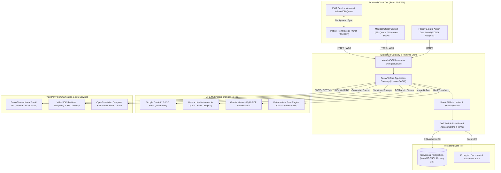
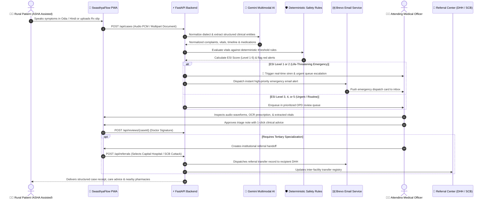
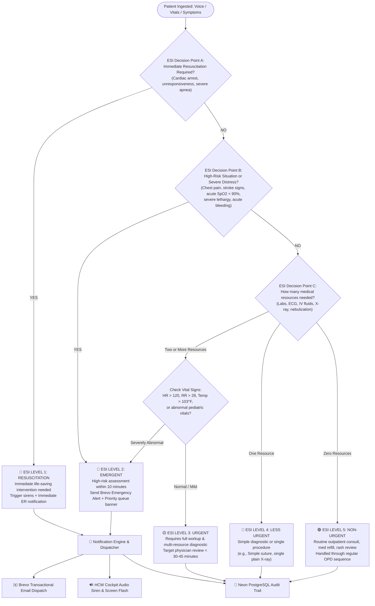
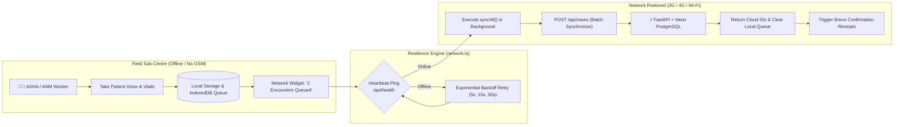
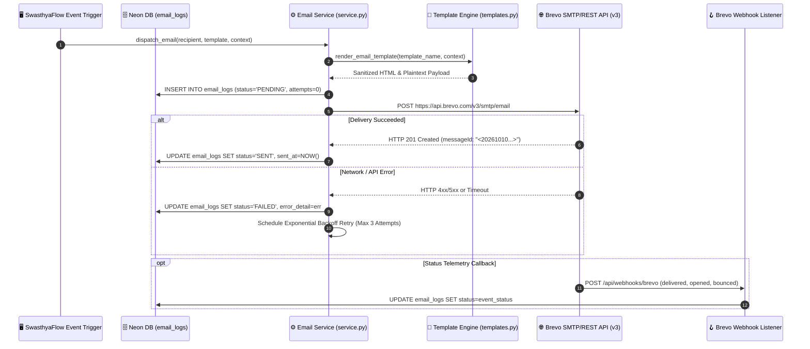
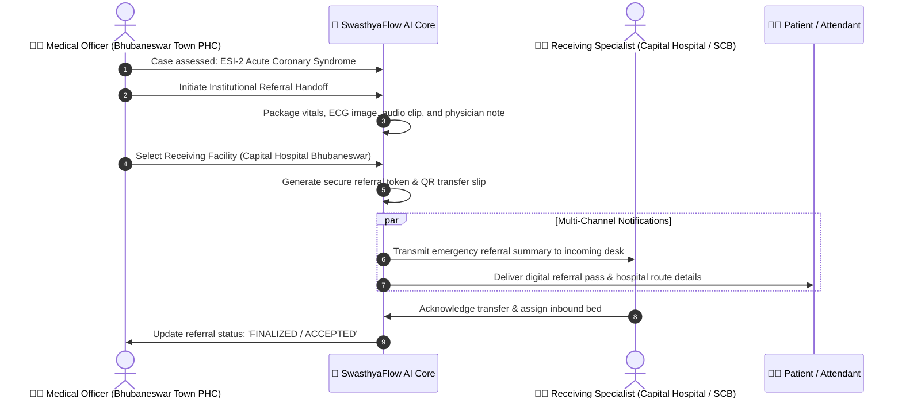
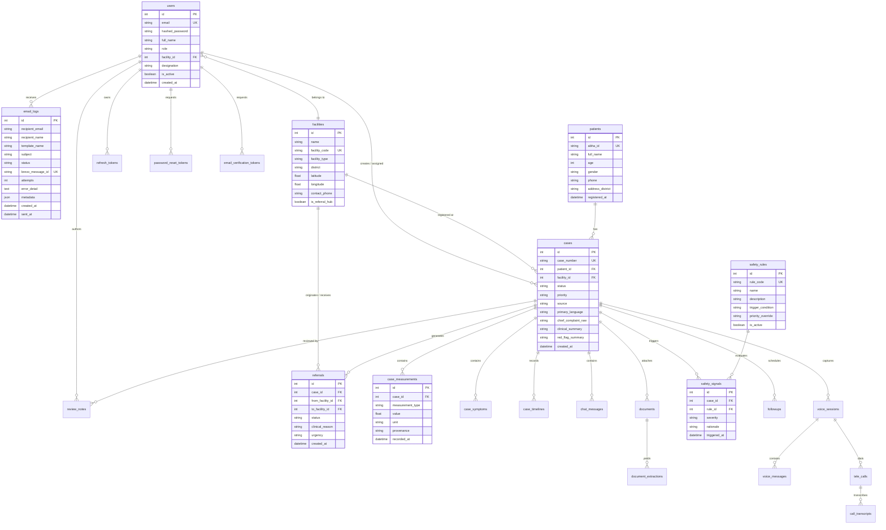

<div align="center">

# 🏥 SwasthyaFlow AI (SwasthyaTriage AI)
### Intelligent Multimodal Clinical Triage, Emergency Prioritization & Institutional Handoff Platform

[](https://python.org)
[](https://fastapi.tiangolo.com)
[](https://react.dev)
[](https://typescriptlang.org)
[](https://vitejs.dev)
[](https://tailwindcss.com)
[](https://neon.tech)
[](https://deepmind.google/technologies/gemini/)
[](https://brevo.com)
[](LICENSE)

*Developed for Primary Healthcare Centers (PHCs), Community Health Centers (CHCs), and District Headquarters Hospitals (DHHs).*  
*Aligned with Odisha Public Healthcare, Ayushman Bharat Digital Mission (ABDM), and BPUT HealthTech Innovation.*

</div>

---

## 📋 Table of Contents
- [Executive Overview](#-executive-overview)
- [The Healthcare Problem & Our Solution](#-the-healthcare-problem--our-solution)
- [Core Architecture & System Diagrams](#-core-architecture--system-diagrams)
  - [1. High-Level System Architecture](#1-high-level-system-architecture)
  - [2. End-to-End Multimodal Triage Lifecycle](#2-end-to-end-multimodal-triage-lifecycle)
  - [3. Deterministic Emergency Severity Index (ESI) Flowchart](#3-deterministic-emergency-severity-index-esi-flowchart)
  - [4. Resilient Offline PWA Sync Queue Engine](#4-resilient-offline-pwa-sync-queue-engine)
  - [5. Brevo Transactional Email & Telemetry Pipeline](#5-brevo-transactional-email--telemetry-pipeline)
  - [6. Inter-Facility Referral & Handoff Sequence](#6-inter-facility-referral--handoff-sequence)
  - [7. Relational Database Schema (ERD)](#7-relational-database-schema-erd)
- [Key Modules & Platform Capabilities](#-key-modules--platform-capabilities)
  - [Multimodal Ingestion (Odia, Hindi, English)](#-multimodal-ingestion-odia-hindi-english)
  - [Deterministic Emergency Severity Index (ESI) Engine](#-deterministic-emergency-severity-index-esi-engine)
  - [Healthcare Worker Cockpit & Rapid Review](#-healthcare-worker-cockpit--rapid-review)
  - [Brevo Transactional Email System](#-brevo-transactional-email-system)
  - [Odisha Healthcare Directory & Jan Aushadhi Locator](#-odisha-healthcare-directory--jan-aushadhi-locator)
  - [Offline Sync Queue for Remote Sub-Centres](#-offline-sync-queue-for-remote-sub-centres)
  - [CDMO Multi-Sheet Excel Reporting Engine](#-cdmo-multi-sheet-excel-reporting-engine)
  - [Strict Single-Role Isolation & Enterprise Security](#-strict-single-role-isolation--enterprise-security)
- [Repository Structure](#-repository-structure)
- [Technology Stack Matrix](#-technology-stack-matrix)
- [Quickstart & Setup Guide](#-quickstart--setup-guide)
  - [Prerequisites](#prerequisites)
  - [Backend Setup (FastAPI + Neon PostgreSQL)](#backend-setup-fastapi--neon-postgresql)
  - [Frontend Setup (React 19 + Vite PWA)](#frontend-setup-react-19--vite-pwa)
  - [Single-Project Vercel Serverless Deployment](#single-project-vercel-serverless-deployment)
- [Demo Credentials & Role Matrix](#-demo-credentials--role-matrix)
- [Environment Variables Reference](#-environment-variables-reference)
- [Testing & Quality Assurance](#-testing--quality-assurance)
- [Clinical Ethics, Safety Net & Disclaimer](#-clinical-ethics-safety-net--disclaimer)
- [License & Acknowledgements](#-license--acknowledgements)

---

## 🌟 Executive Overview

In peripheral public health facilities across India (such as Sub-Centres, PHCs, and CHCs), attending Medical Officers face intense daily OPD volumes exceeding 150-250 patients per shift. Frontline staff must rapidly distinguish between non-urgent complaints and time-critical medical emergencies under extreme constraints:

1. **Rural Linguistic Diversity**: Patients describe complex symptoms in regional dialects (**Odia**, **Hindi**, regional vernacular) that non-native or overburdened doctors struggle to transcribe quickly.
2. **Delayed Emergency Escalation**: Heart attacks, hypertensive crises, acute pediatric dehydration, and respiratory failure languish in standard first-come-first-served queues.
3. **Fragmented Health Records**: Paper slips, handwritten prescriptions, and scattered lab reports lack structured digitization.
4. **Intermittent Rural Connectivity**: Unstable 2G/3G connectivity in tribal and rural areas prevents cloud-only systems from functioning reliably.

**SwasthyaFlow AI (SwasthyaTriage AI)** bridges this gap as an **intelligent clinical decision-support copilot**. It ingests multilingual patient voice descriptions and prescription images, extracts standardized clinical vitals and symptoms, calculates deterministic **Emergency Severity Index (ESI)** urgency levels, and prepares structured pre-encounter summaries for immediate doctor sign-off.

> **Clinical Operating Principle**:  
> *AI assists and structures. Qualified healthcare professionals decide.*  
> SwasthyaFlow AI is non-diagnostic by design and does not replace registered medical practitioners.

---

## 🎯 The Healthcare Problem & Our Solution

```
┌────────────────────────────────────────────────────────┐
│           CURRENT PERIPHERAL HOSPITAL REALITY          │
├────────────────────────────────────────────────────────┤
│ • Chaotic 200+ patient queues with zero triage         │
│ • Critical emergencies wait behind routine colds       │
│ • Dialect & language barriers delay rapid assessment   │
│ • Unreadable handwritten prescription history          │
│ • Paper referral slips lost during transport           │
│ • Zero outbox notifications for patients & families    │
└───────────────────────────┬────────────────────────────┘
                            │
                    TRANSFORMED BY
                            │
                            ▼
┌────────────────────────────────────────────────────────┐
│              SWASTHYAFLOW AI SOLUTION ENGINE           │
├────────────────────────────────────────────────────────┤
│ 1. Voice Ingestion in Odia / Hindi / English (Gemini)  │
│ 2. Vitals & Rx slip OCR extraction (Vision AI)         │
│ 3. Deterministic ESI 5-Level priority scoring          │
│ 4. Immediate siren alert for ESI 1 & 2 emergencies     │
│ 5. Offline PWA Queue with background sync for ANMs     │
│ 6. Verified Directory of Jan Aushadhi & 24/7 Hospitals │
│ 7. Transactional Brevo emails to doctors & patients    │
│ 8. One-click CDMO Excel handoff analytics              │
└────────────────────────────────────────────────────────┘
```

---

## 🏗️ Core Architecture & System Diagrams

### 1. High-Level System Architecture

The following diagram illustrates the modern hybrid architecture of SwasthyaFlow AI, spanning client PWAs, the FastAPI application gateway, serverless PostgreSQL, AI foundation models, transactional communication networks, and geospatial services:



---

### 2. End-to-End Multimodal Triage Lifecycle

The patient journey through SwasthyaFlow AI, from initial multilingual intake to finalized physician sign-off and institutional referral:



---

### 3. Deterministic Emergency Severity Index (ESI) Flowchart

SwasthyaFlow AI enforces a **zero-hallucination deterministic safety net**. Generative AI assists with entity extraction, but patient severity categorization is strictly evaluated using the **Emergency Severity Index (ESI 5-Level Algorithm)** and Odisha Public Health Safety Rules:



---

### 4. Resilient Offline PWA Sync Queue Engine

Healthcare workers in rural Odisha sub-centres frequently encounter zero-connectivity dead zones. SwasthyaFlow AI operates as an **offline-first Progressive Web App (PWA)**:



---

### 5. Brevo Transactional Email & Telemetry Pipeline

SwasthyaFlow AI integrates a dedicated **Brevo Transactional Email System** to provide automated, reliable healthcare communication:



---

### 6. Inter-Facility Referral & Handoff Sequence

Smooth institutional handoffs between peripheral PHCs and tertiary referral centers across Odisha:



---

### 7. Relational Database Schema (ERD)

The complete PostgreSQL relational data model designed with SQLAlchemy 2.0 and managed via Alembic:



---

## 🚀 Key Modules & Platform Capabilities

### 🎙️ Multimodal Ingestion (Odia, Hindi, English)
- **Natural Voice Intake**: Speaks naturally in local dialects. Automatically converts and translates audio into clinical English while preserving verbatim patient statements for forensic accuracy.
- **Document OCR & Prescription Extraction**: Uses Google Gemini Vision paired with PyMuPDF to extract handwritten prescriptions, previous medicine dosages, and diagnostic lab tables.
- **Data Provenance Badges**: Every single field in the pre-encounter record displays its origin tag:
  - `PATIENT_REPORTED` (stated by patient or attendant)
  - `AI_EXTRACTED` (mined from prescription OCR or audio transcription)
  - `CONFIGURED_RULE` (inferred from deterministic clinical logic)
  - `REVIEWER_VERIFIED` (checked and validated by attending doctor)

### 🚨 Deterministic Emergency Severity Index (ESI) Engine
- **Non-Stochastic Safety**: Critical decisions do not rely purely on LLM probability. A deterministic rule engine checks vital sign thresholds against clinical ranges (HR, SpO2, Systolic/Diastolic BP, Temperature, Respiratory Rate).
- **5 ESI Triage Categories**:
  - **ESI 1 (Resuscitation)**: Immediate life threats (apnea, cardiac arrest, profound shock).
  - **ESI 2 (Emergent)**: High-risk conditions (unstable vitals, acute coronary syndromes, severe stroke signs).
  - **ESI 3 (Urgent)**: Multiple diagnostic resources required with stable vitals.
  - **ESI 4 (Less Urgent)**: Single resource needed (e.g., standard suture, single X-ray).
  - **ESI 5 (Non-Urgent)**: Examination only, routine prescription refill.

### 🩺 Healthcare Worker Cockpit & Rapid Review
- **Audio Waveform Inspection**: Doctors can play original voice recordings directly within the case review page to listen to respiratory sounds, wheezing, or emotional distress.
- **Interactive Vitals Monitor**: Color-coded cards highlight abnormal vitals (e.g., SpO2 < 92% flashes crimson; heart rate > 110 bpm flashes amber).
- **One-Click Clinical Advice Modals**: Fast pre-built clinical templates allow doctors to append instant discharge notes, medication advice, or immediate escalation directives in under 5 seconds.

### ✉️ Brevo Transactional Email System
- **Enterprise Delivery**: Backed by Brevo's SMTP and REST v3 API with retry logic and template hydration.
- **Automated Clinical Triggers**:
  - `welcome`: Sent upon new staff or patient registration.
  - `intake_confirmation`: Digital encounter receipt dispatched to the patient.
  - `emergency_alert`: High-priority alert sent to attending doctors when ESI 1 or 2 is flagged.
  - `referral_dispatch`: Instant transfer dossier sent to receiving district hospital desks.
  - `password_reset` & `email_verification`: Cryptographically hashed single-use security tokens.
- **Admin Email Center**: `/app/admin/email/status` provides live delivery metrics, failed retry triggers, and Brevo webhook telemetry.

### 🗺️ Odisha Healthcare Directory & Jan Aushadhi Locator
- **Universal Facility Finder**: Real-time integration with OpenStreetMap (Nominatim & Overpass APIs) covering all districts across Odisha.
- **Jan Aushadhi Kendra Directory**: Locates government generic medicine dispensaries offering essential medicines at subsidized rates (e.g., Paracetamol 650mg, ORS sachets, Metformin, Amoxicillin).
- **24/7 Emergency Hospital Stock**: Identifies 24/7 casualty dispensaries carrying critical emergency stocks (Anti-Snake Venom - ASV, Anti-Rabies Vaccine - ARV, IV fluids).
- **Turn-by-Turn Navigation**: One-click Google Maps routing and direct verified desk helpline dialing.

### 📶 Offline Sync Queue for Remote Sub-Centres
- **Resilient Mobile Operation**: Designed for frontline ASHA and ANM workers in areas with zero or unstable mobile signals.
- **Encounters Outbox**: Stores audio recordings, patient demographics, and vitals in local client storage.
- **Background Sync Engine**: Periodically monitors network reachability. Once 3G/4G or Wi-Fi reconnects, queued cases upload automatically with collision-free handling.

### 📊 CDMO Multi-Sheet Excel Reporting Engine
- **One-Click Official Reporting**: Generates formatted `.xlsx` workbooks for Chief District Medical Officers (CDMO) using `openpyxl`.
- **6 Comprehensive Worksheets**:
  1. *Patient Details*: Demographics, ABHA identifiers, registration dates.
  2. *Cases*: Intake source, ESI priority, clinical summary, assigned staff.
  3. *Voice Sessions*: Duration, audio files, language detected, transcript status.
  4. *Follow-ups*: Due dates, channel used (telecall/chat), completion outcomes.
  5. *Referrals*: Origin facility, destination hospital, urgency, handoff status.
  6. *Audit Summary*: Detailed chronological audit records with IP addresses and timestamps.
- **Styling**: Forest Teal headers (`#0F766E`), zebra-striped rows, and automatic column widths.

### 🔒 Strict Single-Role Isolation & Enterprise Security
- **Strict Role Enforcement**: A single email address is strictly bound to one role (`PATIENT`, `HEALTHCARE_WORKER`, `FACILITY_ADMIN`, or `SUPER_ADMIN`).
- **OAuth & Native Parity**: Unified authentication logic across both email/password credentials and Google OAuth via Clerk.
- **Defense in Depth**: Password hashing via Argon2id, signed short-lived JWT access tokens (15m), secure HTTP-only refresh tokens (7d), and SlowAPI rate limiting.

---

## 📂 Repository Structure

```
├── backend/
│   ├── api/                         # FastAPI REST Route Handlers
│   │   ├── admin.py                 # System administration & user provisioning
│   │   ├── auth.py                  # Login, registration, token refresh & OAuth exchange
│   │   ├── cases.py                 # Case creation, queue queries & status changes
│   │   ├── chat.py                  # Real-time patient & staff conversational intake
│   │   ├── documents.py             # Prescription & lab document uploads
│   │   ├── email_admin.py           # Brevo email telemetry, stats & retry outbox
│   │   ├── exports.py               # Excel and CSV reporting endpoints
│   │   ├── facilities.py            # Healthcare & pharmacy locator (OpenStreetMap GIS)
│   │   ├── followups.py             # Scheduled post-discharge follow-ups
│   │   ├── notifications.py         # In-app notification center alerts
│   │   ├── patients.py              # Patient profile & ABHA identity management
│   │   ├── referrals.py             # Inter-facility hospital transfer handoffs
│   │   ├── reviews.py               # Doctor clinical review & triage sign-off
│   │   ├── safety.py                # Deterministic safety rule management
│   │   ├── telecalls.py             # Outbound telephony & VideoSDK session hooks
│   │   └── voice.py                 # Multimodal voice intake & audio playback
│   ├── auth/                        # Security & Token Infrastructure
│   │   ├── clerk.py                 # Clerk Social OAuth bridge & JWT verification
│   │   ├── dependencies.py          # Fast-fail RBAC route dependency injections
│   │   └── jwt.py                   # PyJWT creation, validation & token rotation
│   ├── database/                    # Persistence Engine
│   │   ├── session.py               # SQLAlchemy 2.0 engine & connection pooling
│   │   └── seed.py                  # Realistic Odisha healthcare synthetic seeder
│   ├── middleware/                  # Request Interceptors
│   │   ├── errors.py                # Standardized JSON error response formatting
│   │   └── ratelimit.py             # SlowAPI IP rate limiting
│   ├── models/                      # SQLAlchemy 2.0 ORM Declarations
│   │   ├── case.py                  # Cases, measurements, symptoms, timelines, review notes
│   │   ├── conversation.py          # Real-time chat messages
│   │   ├── documents.py             # Uploaded files and OCR extractions
│   │   ├── email.py                 # EmailLog, PasswordResetToken, EmailVerificationToken
│   │   ├── enums.py                 # Role, Priority, CaseStatus, ESI, Provenance enums
│   │   ├── safety.py                # SafetyRule and SafetySignal tables
│   │   ├── user.py                  # User, Patient, Facility, RefreshToken
│   │   ├── voice.py                 # VoiceSession, TeleCall, CallTranscript
│   │   └── workflow.py              # Referral, FollowUp, Notification, AuditLog
│   ├── schemas/                     # Pydantic v2 Request/Response Contracts
│   ├── services/                    # Business Logic & Integrations
│   │   ├── audit.py                 # Audit logging helper
│   │   ├── email/                   # Brevo Transactional Email Engine
│   │   │   ├── brevo.py             # Brevo HTTP API v3 client with retries
│   │   │   ├── service.py           # High-level dispatching & token generator
│   │   │   └── templates.py         # Responsive HTML email templates
│   │   ├── exports/                 # Multi-sheet Excel generator (openpyxl)
│   │   ├── gemini/                  # Google Gemini 2.5/3 multimodal integration
│   │   ├── ocr/                     # Prescription & lab report text extraction
│   │   ├── safety/                  # Deterministic clinical safety rule evaluator
│   │   ├── storage.py               # Local encrypted file storage manager
│   │   ├── telephony/               # VideoSDK and Twilio telephony service
│   │   ├── triage/                  # ESI triage scoring calculator
│   │   └── voice/                   # Gemini Live audio streaming agent
│   ├── tests/                       # Pytest Suite (20 Test Files)
│   │   ├── test_auth_rbac.py        # Strict role isolation & JWT verification tests
│   │   ├── test_brevo_email.py      # Brevo email dispatch, retry & mock tests
│   │   ├── test_cases_api.py        # Case intake, filtering & lifecycle tests
│   │   ├── test_facilities.py       # Healthcare locator GIS & helpline tests
│   │   ├── test_patient_excel.py    # CDMO multi-sheet Excel generator tests
│   │   ├── test_safety_engine.py    # Deterministic ESI rule & vitals tests
│   │   └── ...                      # 14 additional domain test suites
│   ├── config.py                    # Pydantic BaseSettings environment loader
│   ├── main.py                      # FastAPI application factory & SPA fallback
│   ├── pyproject.toml               # Python dependencies and packaging configuration
│   └── requirements.txt             # Production Python package manifest
│
├── frontend/
│   ├── public/                      # Static assets, icons, manifest.webmanifest
│   ├── src/
│   │   ├── components/              # Modular UI Components
│   │   │   ├── AppPermissionsModal.tsx     # Mic, camera, location permission helper
│   │   │   ├── GoogleSignInButton.tsx      # Social OAuth sign-in button
│   │   │   ├── guards.tsx                  # Role-based route protection guards
│   │   │   ├── LanguagePicker.tsx          # English, Hindi, Odia language selector
│   │   │   ├── NetworkStatusWidget.tsx     # Offline queue indicator & manual sync
│   │   │   ├── NotificationCenterDropdown.tsx # Real-time alerts drop-down
│   │   │   └── Layout/                     # AppShell and PublicLayout wrappers
│   │   ├── i18n/                           # Internationalization Locales (en, hi, od)
│   │   ├── lib/                            # Helpers & External Clients
│   │   │   ├── api.ts                      # Axios/Fetch client with token auto-refresh
│   │   │   ├── facilities.ts               # OpenStreetMap GIS directory queries
│   │   │   ├── pharmacies.ts               # Jan Aushadhi & 24/7 pharmacy directory
│   │   │   └── types.ts                    # TypeScript domain interfaces
│   │   ├── pages/                          # Application Screen Views
│   │   │   ├── LandingPage.tsx             # Interactive landing page with live demo
│   │   │   ├── SplashPage.tsx              # Mobile pre-app splash screen
│   │   │   ├── auth/                       # Login, Signup, Reset Password, Email Verify
│   │   │   ├── app/patient/                # Patient Dashboard, Voice Intake, Rx Upload
│   │   │   ├── app/hcw/                    # HCW Dashboard, Queue, Case Review, Reports
│   │   │   ├── app/admin/                  # Facility Admin & Super Admin Dashboards
│   │   │   ├── app/communication/          # Multichannel Communication Centre
│   │   │   ├── app/offline/                # SyncQueuePage for offline-queued encounters
│   │   │   └── app/pharmacies/             # NearbyPharmaciesPage locator
│   │   ├── stores/                         # State Management (Zustand)
│   │   │   ├── auth.ts                     # User identity, tokens & role state
│   │   │   └── network.ts                  # Offline queue, GSM signal & sync state
│   │   ├── App.tsx                         # Client-side React routing configuration
│   │   └── main.tsx                        # Application mount entrypoint
│   ├── package.json                        # Frontend dependencies & scripts
│   └── vite.config.ts                      # Vite build configuration & PWA setup
│
├── build_frontend.py                # Cloud build hook to compile Vite SPA
├── server.py                        # Root ASGI shim for single-project Vercel deployment
├── .env.example                     # Environment template with all required keys
└── .vercelignore                    # Deployment hygiene rules for serverless output
```

---

## 🛠️ Technology Stack Matrix

| Domain | Technology / Library | Version | Purpose & Rationale |
| :--- | :--- | :--- | :--- |
| **Frontend Framework** | **React** | `19.2.x` | Modern reactive UI, concurrent rendering, and hooks architecture |
| **Build Tooling** | **Vite** | `8.3.x` | Ultra-fast HMR and optimized production asset bundling |
| **Language** | **TypeScript** | `5.7+` | Strict static typing across all APIs, states, and data models |
| **Styling** | **Tailwind CSS** | `v4.0` | Utility-first styling with modern CSS variables |
| **Icons** | **Lucide React** | `^1.16` | Clean, accessible clinical iconography |
| **Client State** | **Zustand** | `5.0.x` | Lightweight state management for authentication and offline sync |
| **Server State** | **TanStack React Query** | `5.x` | Intelligent data caching, automatic refetching, and query invalidation |
| **Localization (i18n)** | **i18next** | `^24.x` | Multilingual support for English, Hindi, and Odia (`en`, `hi`, `od`) |
| **PWA & Offline** | **Vite-Plugin-PWA** | `^0.21` | Service Worker caching and offline application shell |
| **Backend Framework** | **FastAPI** | `0.115+` | High-performance asynchronous REST API framework |
| **ASGI Server** | **Uvicorn** | `^0.34` | Production ASGI web server with worker scaling |
| **Database** | **PostgreSQL** | `16+` | Production relational database (Serverless via Neon DB) |
| **ORM** | **SQLAlchemy** | `2.0+` | Type-safe asynchronous/synchronous database ORM |
| **DB Migrations** | **Alembic** | `1.14+` | Automated schema version control and migration tracking |
| **Data Validation** | **Pydantic** | `v2.10+` | Fast runtime schema validation and serialization |
| **Multimodal LLM** | **Google Gemini Flash** | `2.5 / 3.0` | Clinical entity extraction, voice translation, and summarization |
| **Live Audio** | **Gemini Live Audio** | `Native Preview`| Low-latency bidirectional conversational symptom intake |
| **Transactional Email**| **Brevo API (Sendinblue)**| `REST v3` | Welcome emails, emergency alerts, referral dispatches & tokens |
| **GIS & Geocoding** | **OpenStreetMap** | `Overpass API` | Live hospital, clinic, and Jan Aushadhi Kendra directory locator |
| **Telephony** | **VideoSDK** | `REST / SIP` | In-app teleconsultations and outbound telephony rounds |
| **Excel Generation** | **openpyxl** | `^3.1` | Multi-sheet styled CDMO analytics reporting generator |
| **Password Hashing** | **Argon2id (passlib)** | `^1.7` | Memory-hard cryptographic password hashing |
| **Testing** | **pytest** | `8.3+` | Comprehensive test suite with mock adapters for offline execution |

---

## 🚦 Quickstart & Setup Guide

### Prerequisites
Make sure the following runtimes are installed on your workstation:
* **Python**: `3.11` or higher (`python --version`)
* **Node.js**: `20.x` or higher (`node --version`) and `npm`
* **PostgreSQL**: A running PostgreSQL instance or a free serverless database on [Neon.tech](https://neon.tech)
* **Google Gemini API Key**: *(Optional for full AI features; offline deterministic mocks are built-in)*
* **Brevo API Key**: *(Optional for live email dispatch; mock delivery mode operates out-of-the-box)*

---

### Backend Setup (FastAPI + Neon PostgreSQL)

1. **Navigate to the backend directory and set up a virtual environment**:
   ```bash
   # On Windows (PowerShell)
   cd backend
   python -m venv .venv
   .\.venv\Scripts\Activate.ps1

   # On macOS / Linux
   cd backend
   python3 -m venv .venv
   source .venv/bin/activate
   ```

2. **Install Python dependencies**:
   ```bash
   pip install -r requirements.txt
   ```

3. **Configure Environment Variables**:
   Copy `.env.example` from the project root to `backend/.env`:
   ```bash
   cp ../.env.example .env
   ```
   *Edit `.env` to specify your `DATABASE_URL` (Neon PostgreSQL), `JWT_SECRET`, and optional API keys.*

4. **Apply Database Migrations & Seed Synthetic Healthcare Data**:
   ```bash
   alembic upgrade head
   python database/seed.py
   ```
   *The seeder populates sample Odisha facilities, demo clinical users, realistic patient cases, and safety rules.*

5. **Start the FastAPI Development Server**:
   ```bash
   uvicorn main:app --reload --port 8000
   ```
   The backend API is now running at: `http://127.0.0.1:8000`  
   Interactive OpenAPI / Swagger docs: `http://127.0.0.1:8000/docs`

---

### Frontend Setup (React 19 + Vite PWA)

1. **Open a new terminal and navigate to `frontend/`**:
   ```bash
   cd frontend
   npm install
   ```

2. **Start the Vite Development Server**:
   ```bash
   npm run dev
   ```
   The application is accessible at: `http://localhost:5173`

---

### Single-Project Vercel Serverless Deployment

SwasthyaFlow AI includes a root **`server.py`** entrypoint shim and **`build_frontend.py`** cloud hook, allowing both the FastAPI backend and React SPA to deploy as a unified single project on Vercel:

1. **Configure Environment Variables in Vercel**:
   Add `DATABASE_URL`, `JWT_SECRET`, `GEMINI_API_KEY`, and `BREVO_API_KEY` under *Project Settings -> Environment Variables*.
2. **Deploy via Vercel CLI**:
   ```bash
   npm install -g vercel
   vercel
   ```
   *The root `server.py` automatically resolves the backend package on `sys.path` and serves both the API endpoints (`/api/*`) and built SPA frontend.*

---

## 👥 Demo Credentials & Role Matrix

For testing and demonstration, use the pre-configured credentials generated by `database/seed.py`:

> **Default Password for all demo accounts**: `Swasthya@123`

| Role | Email Address | Designation | Facility / Jurisdiction |
| :--- | :--- | :--- | :--- |
| **Super Admin** | `super@swasthyatriage.demo` | State Health Director | Odisha State Directorate |
| **Facility Admin** | `admin.bbsr@swasthyatriage.demo` | Medical Superintendent | Bhubaneswar Town PHC |
| **Healthcare Worker** | `doctor.bbsr@swasthyatriage.demo` | Attending Medical Officer | Bhubaneswar Town PHC |
| **Healthcare Worker** | `nurse.bbsr@swasthyatriage.demo` | Staff Triage Nurse | Bhubaneswar Town PHC |
| **Healthcare Worker** | `doctor.rkl@swasthyatriage.demo` | Casualty Medical Officer | Rourkela Govt Hospital (DHH) |
| **Patient** | `patient.ramesh@swasthyatriage.demo` | Registered Citizen | Bhubaneswar Town PHC |
| **Patient** | `patient.anita@swasthyatriage.demo` | Registered Citizen | Bhubaneswar Town PHC |

*One-click instant login buttons are also available directly on the public [Landing Page](http://localhost:5173/landing).*

---

## ⚙️ Environment Variables Reference

| Variable Name | Default Value | Description |
| :--- | :--- | :--- |
| `DATABASE_URL` | `postgresql+psycopg://...` | Connection URI for Neon PostgreSQL database |
| `JWT_SECRET` | *random string* | Secret key used to sign and verify JSON Web Tokens |
| `JWT_ACCESS_TTL_MINUTES` | `15` | Access token lifetime in minutes |
| `JWT_REFRESH_TTL_DAYS` | `7` | Refresh token lifetime in days |
| `COOKIE_SECURE` | `false` | Set to `true` in production with SSL / HTTPS |
| `GEMINI_API_KEY` | `""` | Google Gemini API key *(falls back to deterministic mock if omitted)* |
| `GEMINI_MODEL` | `gemini-2.5-flash` | Gemini model for multimodal clinical entity extraction |
| `GEMINI_LIVE_MODEL` | `gemini-2.5-flash-native-audio...` | Gemini model for bidirectional live voice interaction |
| `BREVO_API_KEY` | `""` | Brevo REST API key for transactional email dispatches |
| `BREVO_SENDER_EMAIL` | `noreply@swasthyatriage.gov.in`| Sender address displayed on outgoing emails |
| `BREVO_SENDER_NAME` | `SwasthyaFlow AI` | Sender display name |
| `BREVO_REPLY_TO_EMAIL`| `support@swasthyatriage.gov.in`| Reply-to email destination |
| `EMAIL_DELIVERY_MODE` | `mock` | `live` for real Brevo dispatches, or `mock` for local simulation |
| `EMAIL_REQUEST_TIMEOUT_SECONDS` | `10.0` | HTTP request timeout for Brevo API calls |
| `BREVO_WEBHOOK_SECRET`| `""` | Optional webhook secret for delivery status callbacks |
| `APP_BASE_URL` | `http://localhost:5173` | Public base URL used in generated email links |
| `TELEPHONY_PROVIDER` | `mock` | Telephony backend: `mock` or `videosdk` |
| `VIDEOSDK_API_KEY` | `""` | VideoSDK API key for real telecalls |
| `VIDEOSDK_SECRET_KEY` | `""` | VideoSDK secret key for dynamic token generation |
| `CORS_ORIGINS` | `http://localhost:5173,...` | Comma-separated list of allowed CORS origins |
| `MAX_UPLOAD_MB` | `20` | Maximum allowed file upload size (MB) |

---

## 🧪 Testing & Quality Assurance

### Comprehensive Backend Pytest Suite
The backend includes 20 test modules covering security, deterministic ESI logic, Brevo email dispatches, Excel exports, and multimodal pipelines with zero external dependencies:

```bash
cd backend
$env:PYTHONPATH='.'  # PowerShell
pytest tests/test_document_rag.py -v
pytest tests/test_documents_api.py -v
```

**Key Test Suites**:
- `test_auth_rbac.py`: Validates strict single-role isolation and token authentication.
- `test_brevo_email.py`: Tests email outbox logging, Brevo API integration, and mock modes.
- `test_safety_engine.py`: Tests deterministic ESI triage logic and vitals threshold rules.
- `test_patient_excel.py`: Verifies multi-sheet CDMO Excel generator output and styling.
- `test_facilities.py`: Tests OpenStreetMap GIS facility queries and helpline lookup.
- `test_gemini_services.py`: Validates multimodal text and vision extraction mocks.
- `test_referral_lifecycle.py`: Tests inter-facility transfer requests and status transitions.
- `test_telecalls_and_exports.py`: Validates VideoSDK sessions and telecall hooks.

### Frontend Verification & Static Analysis
```bash
cd frontend
# Run TypeScript compilation check
npx tsc --noEmit

# Run high-speed Oxlint check
npm run lint

# Validate production bundle compilation
npm run build
```

---

## 🛡️ Clinical Ethics, Safety Net & Disclaimer

1. **Non-Diagnostic Decision Support**:  
   SwasthyaFlow AI is designed as a clinical information organization and prioritization copilot. It **does not independently diagnose illnesses or prescribe medication**. All triage recommendations, priority categorizations, and clinical notes require explicit review and authorization by a qualified, registered medical practitioner.
2. **Deterministic Safety Override**:  
   Critical vital signs and red-flag symptoms are evaluated using deterministic clinical rules. Emergency escalations (ESI Levels 1 and 2) trigger immediate visual and acoustic alerts without relying on probabilistic model outputs.
3. **Data Provenance & Transparency**:  
   Every piece of information in the medical record is tagged with its provenance (`PATIENT_REPORTED`, `AI_EXTRACTED`, `CONFIGURED_RULE`, `REVIEWER_VERIFIED`), ensuring complete auditability for attending physicians.
4. **Audit Trail**:  
   Every user action, clinical note modification, referral dispatch, and security event is recorded in the `audit_logs` table with timestamps, IP addresses, and user identifiers.
5. **ABDM Alignment**:  
   The data models adhere to Ayushman Bharat Digital Mission (ABDM) standards, supporting Ayushman Bharat Health Account (ABHA) patient identifiers and structured health record exchanges.

---

## 📜 License & Acknowledgements

Developed with ❤️ for frontline healthcare workers and underserved rural communities.  
Licensed under the [MIT License](LICENSE).

*Special thanks to the open-source community, BPUT HealthTech Innovation Lab, Odisha Public Healthcare practitioners, and the engineers behind FastAPI, React, Neon DB, and Google Gemini.*
