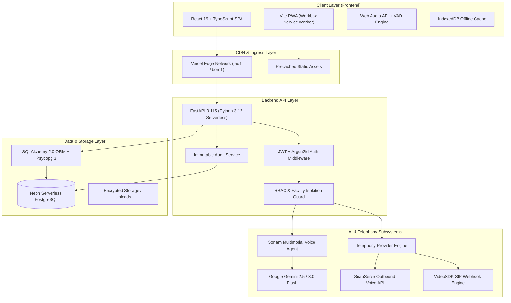
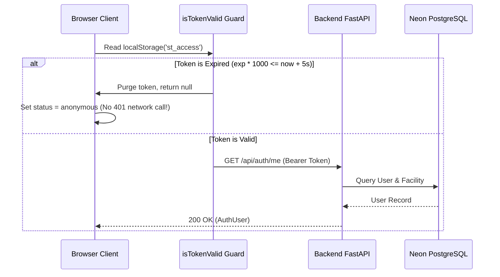

# 🛠️ Technical Requirements Document (TRD)
## SwasthyaFlow AI — Architecture, Telephony, Real-time Voice & Cloud Infrastructure

---

## 1. System Architecture Overview

SwasthyaFlow AI is architected as a modern, high-concurrency, multimodal healthcare platform deployed on a unified serverless cloud architecture.



---

## 2. Technology Stack Matrix

| Layer | Component | Version / Specification | Rationale & Responsibility |
|---|---|---|---|
| **Frontend Framework** | React | 19.2.0 | Next-gen concurrency, hooks, and responsive rendering |
| **Language** | TypeScript | 5.7+ | Strict type safety across clinical schemas and DTOs |
| **Build Tooling** | Vite + Rolldown | 8.3.3 | Sub-second HMR and optimized production bundles |
| **CSS & Design** | Tailwind CSS | v4.0 | Modern utility-first medical design token styling |
| **PWA & Offline** | VitePWA + Workbox | 2.0.0 | Service Worker caching and network resilience |
| **Icons & UI** | Lucide React | Latest | Crisp SVG iconography for clinical workflows |
| **Backend Framework** | FastAPI | 0.115.0+ | Asynchronous high-performance Python ASGI framework |
| **Runtime** | Python | 3.12 (uv / pyproject.toml) | Modern typing, pattern matching, and performance |
| **Database** | PostgreSQL (Neon) | 16+ Serverless | ACID compliance, connection pooling, and branch backups |
| **ORM & Migrations** | SQLAlchemy + Alembic | 2.0.36 / 1.14.0 | Type-annotated mapped columns and schema versioning |
| **DB Driver** | Psycopg 3 | 3.2.3 (Binary) | Native binary async-capable PostgreSQL driver |
| **AI LLM / Vision** | Google Gemini | 2.5 Flash / 3.0 Flash | Multilingual clinical NLP, OCR, and multimodal triage |
| **Telephony / Calls** | SnapServe / VideoSDK | Managed PSTN / SIP | Outbound voice calling and patient callback automation |
| **Email Gateway** | Gmail SMTP / Resend | Dual Provider | Automated welcome, doctor alerts, and referral dispatches |

---

## 3. Real-Time Voice & Sonam Engine

### 3.1 Voice Pipeline Flow
```
[User Mic Input]
       │
       ▼
[Web Audio API (AnalyserNode + VAD)]
       │
       ├── Silence Detected (>1400ms) ──────────┐
       │                                        │
       ▼                                        ▼
[MediaRecorder (audio/webm; codecs=opus)] ──> [Base64 Conversion]
                                                │
                                                ▼
                                    [POST /api/cases/{id}/voice/sessions/{sid}/turns]
                                                │
                                                ▼
                                    [Gemini Multimodal Speech-to-Intent]
                                                │
                                                ▼
                                    [Clinical Extraction & Safety Evaluation]
                                                │
                                                ▼
                                    [JSON Turn Response: Reply + Symptoms + Urgency]
                                                │
                                                ▼
                                    [SpeechSynthesis TTS (Odia/Hindi/English)]
```

### 3.2 Voice Activity Detection (VAD) Implementation
- **Sample Rate & FFT**: AnalyserNode configured with `fftSize: 512` and dynamic frequency analysis.
- **Energy Threshold**: RMS average magnitude $> 18$ triggers `speechDetected = true`.
- **Trailing Silence Cutoff**: Silence duration of $1400\text{ms}$ automatically finalizes the utterance and triggers the backend turn submission.
- **Audio Codec Negotiation**: Automatically falls back: `audio/webm;codecs=opus` $\rightarrow$ `audio/webm` $\rightarrow$ `audio/mp4` based on browser capabilities.

---

## 4. Telephony & Outbound Call Integration

### 4.1 Supported Telephony Providers

```python
_PROVIDERS: dict[str, type[TelephonyProvider]] = {
    "mock": MockTelephonyProvider,
    "videosdk": VideoSDKProvider,
    "snapserve": SnapServeProvider,
}
```

1. **SnapServe AI Provider** (`backend/services/telephony/snapserve.py`):
   - Places real outbound telephone calls via `POST https://app.snapserve.ai/api/calls/outbound`.
   - Uses E.164 phone normalization (`+91XXXXXXXXXX`).
   - Handles webhooks to mirror remote status (`ringing`, `in_progress`, `completed`, `failed`).
   - Server-side lead capture proxy (`POST /api/patients/callback-requests/snapserve-lead`) hides the live API key from the browser.

2. **VideoSDK Provider** (`backend/services/telephony/videosdk.py`):
   - Generates SIP room tokens and initiates outbound bridge calls.
   - Handles Twilio / Exotel SIP handoffs.

3. **Mock Provider** (`backend/services/telephony/mock.py`):
   - Deterministic testing and local development driver.
   - Truthfully flags calls as simulated when live telephony credentials are unconfigured.

---

## 5. Security & Authentication Architecture

### 5.1 Token Lifecycle & Expiration Guard


### 5.2 Strict Role-Based Access Control (RBAC)
- **Role Hierarchy**:
  - `PATIENT`: Can only create/view own cases, initiate voice sessions, and request callbacks.
  - `HEALTHCARE_WORKER`: Access to facility triage queue, vitals entry, follow-ups, and tele-calls.
  - `FACILITY_ADMIN`: Full access to facility resources, staff accounts, and hospital settings.
  - `SUPER_ADMIN`: District-wide access, clinical SOP configuration, and system-wide audits.
- **Facility Isolation Enforcement**:
  ```python
  if user.role != Role.SUPER_ADMIN:
      if user.facility_id is None:
          raise AppError("No facility assigned", status_code=403)
      stmt = stmt.join(Case, ...).where(Case.facility_id == user.facility_id)
  ```

---

## 6. Service Worker & PWA Caching Strategy

- **Workbox Configuration**:
  - `navigateFallback: null`: Disables default navigation fallback bound to `index.html`, eliminating the `non-precached-url: index.html` crash.
  - `globPatterns: ['**/*.{js,css,svg,png,woff2}']`: Precaches compiled JavaScript, stylesheets, fonts, and branding icons.
  - `runtimeCaching`: Routes all `/api/*` requests strictly through `NetworkOnly` to prevent stale clinical data.
- **Client Cache Purging**: Injected script in `<head>` ensures seamless cache invalidation on deployment transitions.

---

## 7. API Route Directory & Specifications

| Method | Endpoint | Access Role | Description |
|---|---|---|---|
| `POST` | `/api/auth/login` | Public | Authenticates user; issues JWT and HttpOnly refresh cookie |
| `POST` | `/api/auth/refresh` | Public | Rotates refresh token; returns fresh access token |
| `GET` | `/api/auth/me` | Authenticated | Retrieves current user profile and facility binding |
| `POST` | `/api/cases` | Patient / Staff | Creates draft clinical triage case |
| `POST` | `/api/cases/{id}/submit` | Patient / Staff | Finalizes case; transitions status to `SUBMITTED` for doctor queue |
| `POST` | `/api/cases/{id}/voice/sessions` | Patient | Spawns real-time Sonam voice intake session |
| `POST` | `/api/cases/{id}/voice/sessions/{sid}/turns` | Patient | Submits audio/text turn; receives AI clinical extraction & reply |
| `POST` | `/api/patients/callback-requests` | Patient | Queues an outbound telephone callback |
| `POST` | `/api/patients/callback-requests/snapserve-lead` | Patient | Proxies patient lead capture to SnapServe |
| `GET` | `/api/telecalls` | Staff | Retrieves tele-call records scoped by facility |
| `GET` | `/api/followups` | Staff | Lists clinical follow-up obligations |
| `GET` | `/api/notifications` | Authenticated | Fetches user notifications and unread badges |
| `GET` | `/api/health` | Public | System liveness probe (DB, storage, Gemini, email) |
